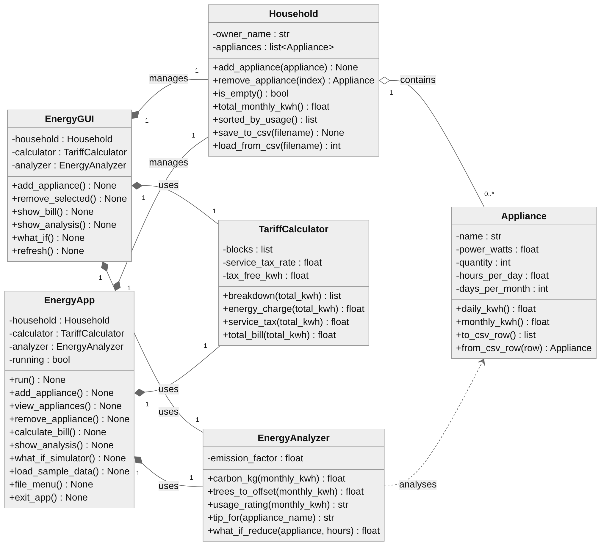
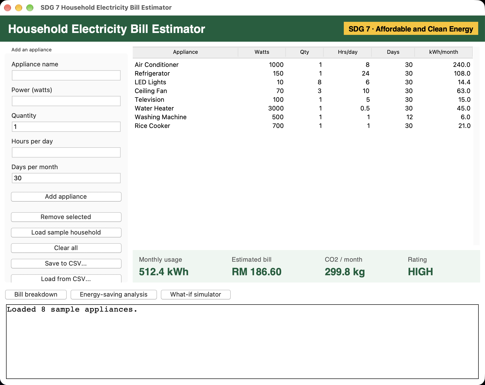
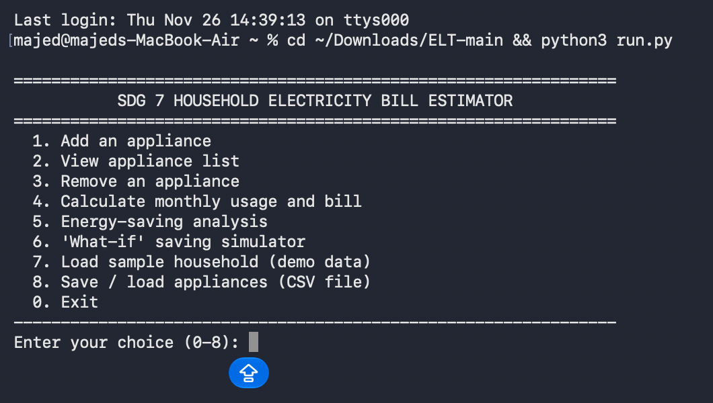
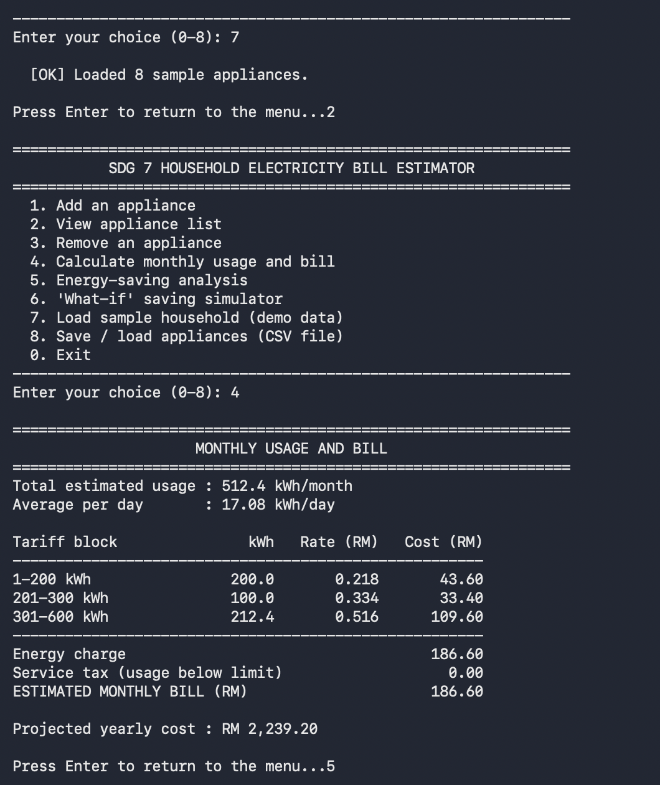
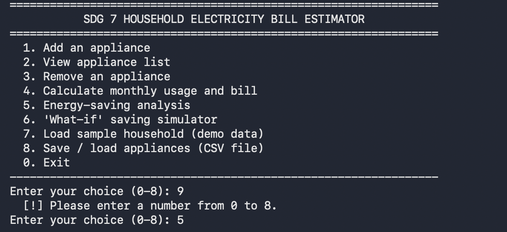
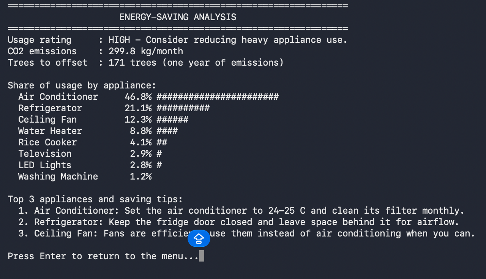

# Household Electricity Bill Estimator: A Computational Thinking Solution for SDG 7

**Course:** Computational Thinking

**Group members:**

- Isameldin Widaatalla Taha Omer _[matric no.]_
- Mohamed Abdelmajed Ahmed _[matric no.]_

**GitHub repository:** https://github.com/mh9d/ELT

---

## 1. Introduction & SDG Background

In 2015 the United Nations agreed on 17 Sustainable Development Goals (SDGs) that all member
countries are meant to reach by 2030. For this project we chose **SDG 7: Affordable and Clean
Energy**, which asks the world to "ensure access to affordable, reliable, sustainable and modern
energy for all".

SDG 7 is often talked about in terms of people who have no electricity at all, and that problem
is still large. According to *Tracking SDG 7: The Energy Progress Report 2025*, more than
**666 million people** were still living without electricity in 2023, even though almost **92%**
of the world now has basic access. About **2.1 billion people** still cook with polluting fuels,
and renewable energy made up only **17.9%** of total final energy consumption in 2022
(World Bank, 2025).

The goal is not only about access, though. Target 7.3 is about using energy more efficiently.
The same report says global energy intensity improved by **2.1%** in 2022, while the world needs
about **4% a year** to stay on track. In other words, getting more out of every unit of energy is
one of the areas where the world is furthest behind, and it is something ordinary households can
actually help with.

The two SDG 7 targets that matter most for our project are:

| Target | What it says | How our app relates to it |
|---|---|---|
| 7.1 | Universal access to affordable, reliable and modern energy services | Helps families predict and control their monthly bill so electricity stays affordable |
| 7.3 | Double the global rate of improvement in energy efficiency | Shows which appliances use the most energy and how much is saved by changing habits |

Malaysia is a good example of why household efficiency matters. Almost every home in Peninsular
Malaysia is connected to the grid, so access is not really the issue here. The issue is that a
large part of the electricity still comes from fossil fuels. The Energy Commission's provisional
grid emission factor for Peninsular Malaysia was **0.740 tonnes of CO2 per MWh in 2024**
(0.760 in 2023 and 0.769 in 2022). That means every kilowatt-hour a household uses releases
roughly three quarters of a kilogram of CO2. Sarawak, which relies heavily on hydropower, is much
lower at 0.199 (Suruhanjaya Tenaga, 2026).

| Region | 2022 | 2023 | 2024 |
|---|---|---|---|
| Peninsular Malaysia | 0.769 | 0.760 | 0.740 |
| Sabah | 0.531 | 0.545 | 0.539 |
| Sarawak | 0.199 | 0.206 | 0.199 |

*Table 1. Grid emission factor in Malaysia (tCO2/MWh, provisional). Source: Suruhanjaya Tenaga (2026).*

**Why we picked SDG 7.** We wanted a problem that every member of our group, and most of our
classmates, deals with directly. Everyone pays (or their parents pay) an electricity bill, but
very few people know where that money actually goes. A small program can answer that question
with simple arithmetic, which made it a good fit for the programming concepts we learned this
semester. Since using less electricity also means burning less fuel, the app supports **SDG 13
(Climate Action)** as well.

## 2. Problem Statement

Most households only see one number on their electricity bill: the total. The bill does not say
how much of that came from the air conditioner and how much came from the fridge or the water
heater. Because of this, people often try to save energy in ways that make very little
difference (for example switching off one light) while ignoring the appliance that is really
driving the cost.

The way electricity is priced makes this worse. Malaysian domestic tariffs have used **block
(tiered) pricing**, where each extra block of kilowatt-hours is charged at a higher rate. In the
tariff we used, the first 200 kWh cost 21.8 sen each, but anything above 900 kWh costs 57.1 sen,
which is more than two and a half times as much. So a household that uses a lot of electricity
does not just pay more, it pays more *per unit*.

Put simply, the problem we want to solve is this:

> Households do not have an easy way to see how much electricity each appliance uses, what it
> costs them under a tiered tariff, and how much they would save by changing their habits. As a
> result they pay higher bills than necessary and produce more CO2 than they need to.

## 3. System Objectives

Based on the problem above, we set six objectives for the application:

1. Let the user record each appliance in their home with its power rating, quantity, daily hours
   of use and days of use per month.
2. Calculate the daily and monthly energy use (kWh) of every appliance and of the whole home.
3. Estimate the monthly electricity bill using a tiered tariff and show how the bill is built up
   block by block.
4. Analyse the results by giving a usage rating, estimating CO2 emissions, ranking the appliances
   that use the most energy and giving a saving tip for each.
5. Let the user try "what-if" scenarios, for example "what if I use the air conditioner two
   hours less a day?", and show the money, energy and CO2 saved.
6. Provide a menu-driven program that does not crash when the user types something wrong.

## 4. Application Design

### 4.1 How we used computational thinking

**Decomposition.** At first "help people save electricity" felt too big to code. We broke it down
by asking what a person would actually want to do with the app, and ended up with six smaller
tasks: record appliances, work out kWh, work out the bill, analyse the result, test what-if
changes, and save or load the data. Each task became either its own class or a group of methods,
which made it easier to split the work between the two of us and to test each part separately.

| Sub-problem | Where it is solved |
|---|---|
| Store one appliance and its usage | `Appliance` class |
| Keep a list of appliances and total them | `Household` class |
| Turn kWh into ringgit | `TariffCalculator` class |
| Rating, CO2, tips, what-if | `EnergyAnalyzer` class |
| Menu and user interaction | `EnergyApp` (console) and `EnergyGUI` (window) |
| Check user input | functions in `utils/validation.py` |

**Pattern recognition.** While working out examples on paper we noticed the same calculation kept
coming up. Whether it is a fan or an air conditioner, the energy is always
power × quantity × hours × days ÷ 1000. So we wrote that formula once inside the `Appliance`
class instead of repeating it. The tariff showed a similar pattern: every block is handled the
same way (take the kWh that fall into the block and multiply by its rate), so one loop can handle
any number of blocks. We also noticed that appliance names usually contain a keyword like "air",
"light" or "heater", which let us match saving tips with a simple keyword search.

**Abstraction.** A real appliance has a brand, model, colour, age and so on, but none of that
affects the bill estimate. We kept only the five pieces of information that matter: name, watts,
quantity, hours per day and days per month. In the same way, the tariff rates and the emission
factor are stored as constants at the top of their files, so the rest of the program does not
need to know the actual numbers. If the tariff changes, only one list needs to be edited.

**Algorithm design.** For each main feature we wrote out the steps in plain English before
writing any Python. The tiered bill algorithm, the usage rating and the what-if calculation are
described step by step in Section 5.3.

### 4.2 UML class diagram

**Figure 1. UML class diagram of the application**



The diagram shows six classes and how they relate:

- **EnergyApp** is the console controller. It owns one `Household`, one `TariffCalculator` and one
  `EnergyAnalyzer` (composition) and runs the menu loop.
- **EnergyGUI** is the optional window version. It owns the same three objects, so both interfaces
  share exactly the same logic.
- **Household** holds zero or more `Appliance` objects (aggregation). It can total their usage,
  sort them and save or load them from a CSV file.
- **Appliance** stores the five values described above and calculates its own daily and monthly kWh.
- **TariffCalculator** applies the block rates and the service tax.
- **EnergyAnalyzer** handles the usage rating, CO2, trees needed to offset it, saving tips and the
  what-if calculation. It depends on `Appliance` when it analyses one device.

### 4.3 Package structure

We organised the code into packages so that data, calculations and the user interface are kept
apart.

```
energy_saver/
├── main.py / __main__.py   entry point
├── app.py                  EnergyApp (menu + features)
├── models/                 Appliance, Household
├── services/               TariffCalculator, EnergyAnalyzer
├── utils/validation.py     get_text, get_int, get_float, get_yes_no
├── ui/display.py           display_main_menu, display_appliance_table, display_bill, ...
└── ui/gui.py               EnergyGUI (optional Tkinter window)
tests/test_calculations.py  unit tests
```

## 5. Implementation Details

### 5.1 How the program meets the course requirements

| Requirement | Where we used it |
|---|---|
| Menu loop | `EnergyApp.run()` uses `while self.running:` to show the menu until the user exits |
| `input()` | all input goes through the functions in `utils/validation.py` |
| Formatted output | f-strings with fixed widths and decimals in `ui/display.py` for the tables, bill and bar chart |
| Variables and data types | `str` (names), `float` (watts, hours, rates), `int` (quantity, days), `list` (appliances), `dict` (tips, menu actions), `tuple` (tariff blocks), `bool` (running flag) |
| Operators | arithmetic `* / + - //`, comparison `<= > <`, logical `and or not in` |
| At least five user-defined functions | more than 30 functions and methods, for example `display_main_menu`, `add_appliance`, `calculate_bill`, `show_analysis`, `what_if_simulator`, `exit_app`, `get_float`, `get_int` |
| if / elif / else | `usage_rating()`, every validation function, `display_bill()` |
| for and while loops | `for` over appliances and tariff blocks, `while` in the menu and in validation |
| Error handling | `try/except ValueError` when converting numbers, range checks, rejecting `nan` and `inf`, `FileNotFoundError` and `OSError` for files, Ctrl+C handled in `main()` |
| Comments | every module, class and function has a docstring, and formulas have inline comments |
| Coding style | 4-space indentation, descriptive names such as `total_monthly_kwh` and `hours_per_day` |

### 5.2 Optional graphical interface

The brief only asks for a console program, and that is still the main version. We also added a
small window version (`python3 run_gui.py`) using **Tkinter**, which comes with Python. We did
not copy any of the calculations into it. The `EnergyGUI` class simply creates the same
`Household`, `TariffCalculator` and `EnergyAnalyzer` objects and calls their methods. For us this
was a good test of our design: because we had separated the logic from the interface, adding a
whole new interface only meant writing one new file.

**Figure 2. Optional Tkinter window on macOS with the sample household loaded**



### 5.3 Key algorithms

**Energy of one appliance**

```
daily_kwh   = power_watts × quantity × hours_per_day ÷ 1000
monthly_kwh = daily_kwh × days_per_month
```

For example, a 1,000 W air conditioner running 8 hours a day for 30 days uses
1000 × 1 × 8 × 30 ÷ 1000 = **240 kWh** a month.

**Tiered bill.** This is the part we spent the most time on, because our first attempt
multiplied the whole usage by a single rate, which is wrong. The final algorithm is:

1. Set `remaining` to the total kWh.
2. Go through the tariff blocks in order. For each block, take
   `used = min(remaining, block size)`. The last block has no size limit, so it takes everything
   that is left.
3. Add `used × rate` to the energy charge and subtract `used` from `remaining`.
4. Stop when `remaining` reaches 0.
5. If the total is above 600 kWh, add 8% service tax on the energy charge.
6. Round the final bill to two decimal places.

| Block | Rate (RM per kWh) |
|---|---|
| 1 to 200 kWh | 0.218 |
| 201 to 300 kWh | 0.334 |
| 301 to 600 kWh | 0.516 |
| 601 to 900 kWh | 0.546 |
| Above 900 kWh | 0.571 |

*Table 2. Tariff blocks used in the program. These follow the earlier Malaysian domestic block
tariff and are used for learning purposes. [Check with your lecturer whether the current official
tariff should be used instead.]*

Worked example for 512.4 kWh: 200 × 0.218 = RM 43.60, plus 100 × 0.334 = RM 33.40, plus
212.4 × 0.516 = RM 109.60, which gives **RM 186.60**. There is no tax because the usage is below
600 kWh.

**Usage rating.** A simple `if / elif / else` chain: 200 kWh or less is LOW, up to 400 is
MODERATE, up to 600 is HIGH, and anything above is VERY HIGH. We chose these limits to line up
roughly with the tariff blocks, so a higher rating also means a more expensive rate per unit.

**Carbon footprint.** CO2 (kg) = kWh × 0.585. The number of trees needed to absorb a year of
emissions is the yearly CO2 divided by 21 kg, a commonly quoted figure for what one mature tree
absorbs in a year. (Section 7.2 explains why this emission factor is on the low side.)

**What-if simulation.** Saved kWh = power × quantity × hours cut × days ÷ 1000. We cap the hours
cut at the appliance's current hours, so the user cannot "save" more than the appliance uses.
The new bill is then recalculated from the new total, not just the saved kWh times one rate,
so the tiered effect is included.

### 5.4 Code excerpts

The tiered bill loop in `TariffCalculator`:

```python
def breakdown(self, total_kwh):
    rows = []
    remaining = total_kwh
    lower = 0
    for size, rate in self.blocks:
        if remaining <= 0:
            break
        used = remaining if size is None else min(remaining, size)
        ...
        rows.append((label, used, rate, used * rate))
        remaining -= used
```

Input validation is handled by small reusable functions. `get_float` keeps asking until the user
types a real number inside the allowed range:

```python
def get_float(prompt, minimum=0.0, maximum=None):
    while True:
        raw = input(prompt).strip()
        try:
            value = float(raw)
        except ValueError:
            print("  [!] Please enter a number (e.g. 1500 or 2.5).")
            continue
        if not math.isfinite(value):
            print("  [!] Please enter a real number.")
        elif value < minimum:
            print(f"  [!] Value must be at least {minimum:g}.")
        elif maximum is not None and value > maximum:
            print(f"  [!] Value must not exceed {maximum:g}.")
        else:
            return value
```

## 6. Testing & Sample Outputs

### 6.1 Test cases

We tested the program in two ways: by running it by hand with good and bad inputs, and with
automated unit tests (`python3 -m unittest -v`) that check the calculations. All 10 unit tests
pass.

| # | What we tested | Input | Expected result | Result |
|---|---|---|---|---|
| T1 | Letters in the menu | `abc` | "Please enter a whole number." and ask again | Pass |
| T2 | Menu number too high | `9` | "Please enter a number from 0 to 8." | Pass |
| T3 | Negative menu number | `-1` | Range message, ask again | Pass |
| T4 | Calculate with no appliances | option 4 on empty list | Warning, back to menu | Pass |
| T5 | Empty appliance name | blank | "This field cannot be empty." | Pass |
| T6 | Name too long | 45 characters | "Please keep it under 40 characters." | Pass |
| T7 | Watts not a number | `lots` | "Please enter a number" | Pass |
| T8 | Negative watts | `-5` | "Value must be at least 1." | Pass |
| T9 | Watts = `nan` | `nan` | "Please enter a real number." | Pass |
| T10 | Decimal quantity | `1.5` | "Please enter a whole number." | Pass |
| T11 | Hours above 24 | `30` | "Value must not exceed 24." | Pass |
| T12 | Days above 31 | `40` | Range message | Pass |
| T13 | Invalid yes/no answer | `maybe` | "Please answer 'y' or 'n'." | Pass |
| T14 | kWh of one appliance | 1000 W, 1, 8 h, 30 days | 240.0 kWh | Pass |
| T15 | Quantity is multiplied | 10 W, 8 bulbs, 6 h, 30 days | 14.4 kWh | Pass |
| T16 | Bill in first block | 100 kWh | RM 21.80 | Pass |
| T17 | Bill across two blocks | 250 kWh | RM 60.30 | Pass |
| T18 | Bill for sample home | 512.4 kWh | RM 186.60 | Pass |
| T19 | Service tax applied | 700 kWh | energy charge × 1.08 = RM 309.31 | Pass |
| T20 | Zero usage | 0 kWh | RM 0.00 | Pass |
| T21 | Rating boundaries | 200 / 201 / 601 kWh | LOW / MODERATE / VERY HIGH | Pass |
| T22 | What-if is capped | TV 5 h/day, cut 10 h | saves 15 kWh (not 30) | Pass |
| T23 | What-if result | AC cut 3 h/day | saves 90 kWh and RM 46.44 a month | Pass |
| T24 | Remove appliance | remove no. 7 | list goes from 8 to 7 items | Pass |
| T25 | Save and load CSV | save, then load | the same appliances come back | Pass |
| T26 | Load a missing file | `x.csv` | "File 'x.csv' was not found." | Pass |
| T27 | Exit confirmation | `0` then `n` | stays in the program | Pass |

*Table 3. Test cases.*

### 6.2 Results from three example households

To see whether the results make sense, we entered three different households into the app. The
"terrace house" is the built-in sample data (option 7). The other two were entered by hand.

| Household | Main appliances | kWh / month | Bill (RM) | Average sen / kWh | CO2 (kg / month) | Rating |
|---|---|---|---|---|---|---|
| Small apartment, 1 to 2 people | fridge, 5 LED lights, 2 fans, TV, laptop, rice cooker, short heater use | 174.9 | 38.13 | 21.8 | 102.3 | LOW |
| Terrace house, 4 people | 1 air conditioner (8 h), fridge, 3 fans, water heater, others | 512.4 | 186.60 | 36.4 | 299.8 | HIGH |
| Large house, 6 people | 3 air conditioners (8 h each), 2 water heaters, desktop PC, others | 1175.2 | 596.96 | 50.8 | 687.5 | VERY HIGH |

*Table 4. App results for three households (CO2 at 0.585 kg/kWh).*

The column we found most interesting is the average cost per kWh. The large house uses about
6.7 times more electricity than the apartment, but pays almost **15.7 times more**, because most
of its usage falls in the expensive blocks. It is also the only one of the three that pays
service tax (RM 44.22).

The same effect shows up when we run the bill calculation for different usage levels:

| Monthly usage (kWh) | 100 | 200 | 300 | 400 | 500 | 600 | 700 | 900 | 1200 |
|---|---|---|---|---|---|---|---|---|---|
| Bill (RM) | 21.80 | 43.60 | 77.00 | 128.60 | 180.20 | 231.80 | 309.31 | 427.25 | 612.25 |
| Average cost (sen/kWh) | 21.8 | 21.8 | 25.7 | 32.1 | 36.0 | 38.6 | 44.2 | 47.5 | 51.0 |

*Table 5. Bill and average cost per kWh at different usage levels.*

### 6.3 What-if results for the sample household

Using option 6 on the terrace house (512.4 kWh, RM 186.60) gave the following savings:

| Change | Cut | kWh saved / month | RM saved / month | RM saved / year | CO2 avoided (kg / month) |
|---|---|---|---|---|---|
| Air conditioner | 1 h/day | 30.0 | 15.48 | 185.76 | 17.5 |
| Air conditioner | 2 h/day | 60.0 | 30.96 | 371.52 | 35.1 |
| Air conditioner | 3 h/day | 90.0 | 46.44 | 557.28 | 52.6 |
| Water heater | 15 min/day | 22.5 | 11.61 | 139.32 | 13.2 |
| Ceiling fans | 2 h/day | 12.6 | 6.50 | 78.00 | 7.4 |
| Rice cooker | 30 min/day | 10.5 | 5.42 | 65.04 | 6.1 |
| Television | 2 h/day | 6.0 | 3.10 | 37.20 | 3.5 |

*Table 6. What-if savings for the sample household.*

We also checked lighting separately. Eight 60 W incandescent bulbs used 6 hours a day would use
86.4 kWh a month, compared with 14.4 kWh for eight 10 W LEDs. In the sample home that difference
alone would add about **RM 37 a month** to the bill.

### 6.4 Screenshots

The screenshots below were taken while running the program in the macOS Terminal
(`python3 run.py`). The full text of one test session is in `docs/sample_output.txt`.

**Figure 3. Main menu when the program starts**



**Figure 4. Loading the sample household (option 7) and calculating the monthly bill (option 4)**



**Figure 5. Input validation: the menu choice `9` is rejected and the user is asked again**



**Figure 6. Energy-saving analysis (option 5) with rating, CO2, usage share chart and tips**



## 7. Discussion & Limitations

### 7.1 What the results tell us

The clearest finding is how much one appliance can dominate. In the sample home, the air
conditioner alone is **46.8%** of all electricity used, and together with the fridge it is almost
68%. The LED lights, which people usually think of first when they want to save electricity, are
only 2.8%. We expected something like this, but it was still surprising to see it in numbers.

The second finding is how the tiered tariff rewards small changes. Cutting the air conditioner by
three hours reduces usage by 17.6%, but the bill drops by about 24.9%, because the kWh that are
removed come from the most expensive block. Table 6 shows that even one hour less of air
conditioning saves more than RM 185 a year, which is more than the TV, fan and rice cooker
changes put together.

We think this is where the app is most useful for SDG 7. It does not just say "save energy". It
tells the user which change is worth making, how much money it is worth, and how much CO2 it
avoids. That kind of specific feedback is more likely to change behaviour than general advice.

### 7.2 Limitations

1. **Estimates, not measurements.** The app uses the rated power on the label and the user's own
   guess of hours. In reality an air conditioner or fridge compressor switches on and off, so the
   real usage can be quite a bit lower than the rated value suggests.
2. **Tariff values.** We used the older Malaysian block tariff as a fixed list. Malaysia revised
   its domestic tariff structure in 2025, so the bills shown are useful for comparison but may not
   match a current bill exactly.
3. **Emission factor.** The app uses 0.585 kg CO2/kWh. The Energy Commission's latest provisional
   figure for Peninsular Malaysia is 0.740 (2024), so our CO2 numbers are on the low side. For the
   sample home this would mean 379.2 kg a month instead of 299.8 kg. Because the factor is a single
   constant in `services/analysis.py`, it is easy to update.
4. **No history.** The program does not keep a record of past months, so a user cannot track
   whether their usage is going down over time.
5. **Simple tips.** Tips are matched by keywords in the appliance name. An appliance with an
   unusual name only gets a general tip.
6. **Basic interface.** The console menu is easy to use but plain, and the Tkinter window does not
   show graphical charts.

### 7.3 Future improvements

If we continued the project, we would add a solar panel savings estimator, a monthly history so
users can see trends, the current official tariff (or a way to load it from a file), the latest
emission factor with a choice of region, and charts in the window version. A mobile version would
also make it easier for people to enter their appliances while walking around the house.

## 8. Conclusion

We built a Python console application that helps a household understand where its electricity
goes and what it costs. Using decomposition, we split the problem into small parts that each
became a class. Pattern recognition let us write the energy formula and the tariff loop once and
reuse them. Abstraction kept each appliance down to five values and kept the tariff and emission
numbers in one place. Algorithm design gave us a correct tiered bill calculation and a what-if
simulator.

The program meets all the course requirements, including a menu loop, input validation, more
than five user-defined functions, if/elif/else, loops and comments, and it passed all 27 of our
test cases. Our results show that most of a typical home's bill comes from one or two appliances,
and that small changes to those appliances save more than people expect because of the tiered
tariff. By making this visible, the app supports SDG 7 (energy efficiency and affordable bills)
and SDG 13 (lower CO2 emissions).

## References

- IEA, IRENA, UNSD, World Bank & WHO. (2025). *Tracking SDG 7: The energy progress report 2025.* https://www.worldbank.org/en/topic/energy/publication/tracking-sdg-7-the-energy-progress-report-2025
- Python Software Foundation. (n.d.). *Python 3 documentation.* https://docs.python.org/3/
- Suruhanjaya Tenaga. (2026). *Grid emission factor (GEF) in Malaysia 2022–2024 (provisional).* https://myenergystats.st.gov.my/documents/d/guest/grid-emission-factor-gef-in-malaysia-2022-2024-provisional-
- Tenaga Nasional Berhad. (n.d.). *Pricing & tariffs.* https://www.tnb.com.my/residential/pricing-tariffs
- United Nations. (n.d.). *Goal 7: Ensure access to affordable, reliable, sustainable and modern energy for all.* https://sdgs.un.org/goals/goal7
- World Bank. (2025, June 25). *Energy access has improved, yet international financial support still needed to boost progress and address disparities* [Press release]. https://www.worldbank.org/en/news/press-release/2025/06/25/energy-access-has-improved-yet-international-financial-support-still-needed-to-boost-progress-and-address-disparities
